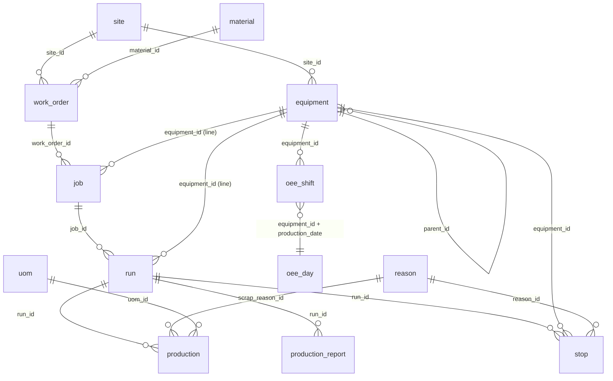

# Reporting on Pulaski data

Pulaski doesn't build dashboards or ad-hoc reports itself (D-129). Instead it gives analysts a **stable, documented, read-only layer** of
the data in PostgreSQL, the `report` schema, to use from Power BI, Excel, Tableau or a warehouse such as Snowflake. This page is that
layer's guide: what each view holds, how its figures are worked out so a report agrees with the app, and how to connect.

## The promise

- **Read the `report` views, not the tables behind them.** Pulaski's own tables (`core`, `ts`, `evt`, `sec`, documented in
  `design/database.md`) change as features are added. The views keep their names, columns and meaning.
- A view changes only by **gaining columns**. Anything that would break a report (a column renamed, dropped or changing meaning) gets a
  new view name, and the old one stays until a release note retires it.
- The reporting login can read the views and nothing else: not the tables, not the event log, not users or passwords, and it can't write.
- Every view is checked against the real schema on every build (`Tests/Pulaski.Infrastructure.Tests/ReportViewTests.cs`).

## Connecting

A database administrator creates one login per tool, a member of `pulaski_report` (made by `db/report-role.sql`, which the database setup
runs):

```sql
CREATE ROLE powerbi LOGIN PASSWORD '…' CONNECTION LIMIT 5;
GRANT pulaski_report TO powerbi;
GRANT CONNECT ON DATABASE pulaski TO powerbi;
-- Settings are per login (a group role's don't pass on): stop long queries, and never write.
ALTER ROLE powerbi SET statement_timeout = '5min';
ALTER ROLE powerbi SET default_transaction_read_only = on;
```

Connect to the `pulaski` database with that login, `sslmode=require` outside the plant network, and choose tables from the `report` schema.
For heavy use, point the login at a read replica rather than the database the floor writes to.

## Conventions

- **Ids** are UUIDs (`…_id`). Join on them, never on codes: a code can be reused once its thing is switched off.
- **Times** are `timestamptz`: an instant, sent in UTC. Show them in the site's time zone (`report.site.time_zone`).
  `site_local_date` is the calendar day at the site, worked out for you. `production_date` (OEE) is the shift's production day, which can
  differ from the calendar day for a night shift.
- **Quantities** are in the unit on the row (`uom_id` → `report.uom`). A material's stock is in its base unit
  (`report.material.base_uom_id`). Pulaski converts units only where it says so; don't add quantities in different units.
- **Nothing is deleted.** Things are switched off (`is_active`), stops replaced by splits and merges are left out of `report.stop`, and a
  reversed report nets to zero. Filter `is_active` for "current" lists, not for history.
- **Codes and statuses** are lower-case English words with underscores (`in_progress`, `equipment_capability`).

## How the views join



Dimensions: `site`, `equipment`, `material`, `uom`, `reason`. Facts: `work_order`, `job`, `run`, `production`, `production_report`, `stop`,
`oee_shift`, `oee_day`.

## Dimensions

### report.site

One row per site. `site_id`, `code`, `name`, `time_zone` (IANA, such as `America/Chicago`), `is_active`.

### report.equipment

One row per piece of equipment below the enterprise: sites, areas, lines, machines, storage. `equipment_id`, `site_id`, `code`, `name`,
`level` (ISA-95: `site`, `area`, `work_center`, `work_unit`…), `role` (`production_line`, `storage_zone`, `feed_point`…), `parent_id` /
`parent_code`; `area_id` / `area_code`, the nearest area above it; `line_id` / `line_code`, the nearest piece that runs jobs, itself included
(so a machine reports under its line); flags `can_run_job`, `is_schedulable`, `holds_inventory`, `tracks_state`, `is_active`.

### report.material

`material_id`, `code`, `name`, `material_type` (`raw`, `finished`, `packaging`…), `class_code` / `class_name`, `base_uom_id` /
`base_uom_code`, `is_lot_tracked`, `shelf_life_days`, `origin` (`local`, `erp`), `external_system` / `external_key` (the ERP's key, for
joining to ERP data), `is_active`.

### report.uom

`uom_id`, `code`, `name`, `dimension` (`mass`, `length`, `count`…).

### report.reason

Reasons of every kind: scrap, holds, stops (utilization), adjustments, SPC causes. `reason_id`, `site_id` (null: every site), `kind`, `code`,
`name`, `utilization_class` (stops: `runtime`, `downtime` or `planned`, which is left out of availability), `oee_impact`, `group_path`
(the groups above it, such as `Mechanical › Die`), `depth`, `is_group` (a group, not chosen itself), `is_active`.

## Production and OEE

### report.production: every change to good and scrap

**Grain:** one row per counted change. **Use it for totals.** `production_id`, `occurred_at` (when it counts: inside its run),
`site_local_date`, `recorded_at` (when it was entered), `equipment_id` (the line), `run_id`, `job_id`, `report_id`, `change_kind`, `good_qty`,
`scrap_qty`, `uom_id`, `scrap_reason_id`, `actor_id`.

`change_kind` is `report` (an operator's or station's report), `reversal` (a report taken back: negative quantities), or `rejection` (a lot
rejected on quality: its quantity moves from good to scrap in the run that made it, without a report). Summed by run, these equal
`report.run.good_qty` and `scrap_qty`. Machine counts aren't reports and aren't here.

### report.production_report: one row per report

**Grain:** one production report, net of any reversal. `report_id`, `job_id`, `run_id`, `equipment_id`, `occurred_at`, `site_local_date`,
`recorded_at`, `good_qty`, `scrap_qty`, `uom_id`, `scrap_reason_id`, `is_reversed` (taken back: nets to zero; a correction is a new report),
`machine_through` (a report from the machine's count: counts up to this time are in it), `reported_by`. Use it for questions about
reports (how many, by whom, how late); for quantities use `report.production`, which also has rejections.

### report.run

**Grain:** one run: a job on a line from start to pause or completion. `run_id`, `job_id`, `equipment_id` (the line), `run_no` (1, 2…
within the job), `started_at`, `ended_at` (null while running), `status` (`running`, `paused`, `ended`), `end_reason_id`, `good_qty`,
`scrap_qty`, `uom_id`, `hours` (to now while running).

### report.stop

**Grain:** one stop as it stands now. `stop_id`, `equipment_id`, `run_id`, `started_at`, `ended_at`, `minutes` (to now while open),
`site_local_date`, `packml_state` / `packml_state_name` (the PackML state it started in), `plc_stop_reason` (the machine's own code),
`reason_id`, `utilization_class`, `is_uncoded`, `is_micro_stop` (shorter than the machine's threshold: not availability loss), `is_open`,
`source` (`machine`, `manual`, `split`, `merge`, `retime`, `restore`, `trim`), `coded_by`, `comment`. Pieces replaced by a split, merge or
retime are left out, so stops never overlap.

### report.oee_shift and report.oee_day

**Grain:** one piece of equipment in one shift (`oee_shift`), or one production day (`oee_day`, its shifts added up). From the daily OEE
rollups, so **only final days are here: up to two days ago.** Today's and yesterday's figures are the app's (Machines → Utilization and OEE).

Columns: `site_id`, `equipment_id`, `production_date`; `oee_shift` also `shift_code`, `shift_name`, `crew`, `window_start`, `window_end`,
`rolled_at`. Hours: `scheduled_hours`, `non_production_hours`, `planned_stop_hours`, `planned_hours`, `run_hours`, `down_hours`,
`micro_stop_hours`, `no_signal_hours` (no machine signal: counted as down), `uncoded_hours`, `run_with_rate_hours`; counts `stops`,
`micro_stops`; output `good_qty`, `scrap_qty` (from production reports, never machine counts), `earned_hours`, `earned_good_hours`; and
`availability`, `performance`, `quality`, `oee` as fractions (0.85 = 85%).

**How OEE is worked out**, exactly as the app does it (D-052):

| Figure | Formula |
| --- | --- |
| Planned time | scheduled − non-production − planned stops |
| Availability | run ÷ planned |
| Performance | earned hours ÷ run time with a rate (earned hours = output ÷ ideal rate) |
| Quality | earned good hours ÷ earned hours |
| OEE | availability × performance × quality |

Output is weighed by each product's ideal rate, so a line making several products in a shift is compared fairly. **Never average the
ratios**: to roll up shifts, days, lines or a site, add the hours and recompute, as `oee_day` does:

```sql
SELECT e.line_code, date_trunc('month', o.production_date) AS month,
       sum(o.run_hours) / nullif(sum(o.planned_hours), 0)            AS availability,
       sum(o.earned_hours) / nullif(sum(o.run_with_rate_hours), 0)   AS performance,
       sum(o.earned_good_hours) / nullif(sum(o.earned_hours), 0)     AS quality
FROM report.oee_day o JOIN report.equipment e USING (equipment_id)
WHERE e.can_run_job
GROUP BY e.line_code, month;
```

## Orders and jobs

### report.work_order

**Grain:** one work order. `work_order_id`, `site_id`, `order_number`, `material_id`, `planned_qty`, `uom_id`, `status` (`planned`,
`dispatched`, `firmed`, `in_progress`, `completed`, `closed`, `cancelled`), `priority`, `planned_start`, `planned_end`, `due_at`, `origin`,
`external_system` / `external_key` (the ERP's order), `created_at`; from its production jobs: `good_qty` and `scrap_qty` (jobs in the order's
unit), `first_started_at`, `last_ended_at`, `job_count`.

### report.job

**Grain:** one job. `job_id`, `site_id`, `work_order_id`, `job_number`, `job_type` (`production`, `changeover`, `maintenance`…),
`equipment_id` (the line it runs on), `group_equipment_id` (the department it was planned to, if any), `material_id`, `operation_number`,
`planned_qty`, `uom_id`, `status`, `planned_start`, `planned_end`, `completed_at`, `created_at`; from its runs: `good_qty`, `scrap_qty`,
`first_started_at`, `last_ended_at`, `run_count`, `run_hours`.

Plan against actual for an order:

```sql
SELECT w.order_number, m.code AS material, w.planned_qty, w.good_qty, w.good_qty / nullif(w.planned_qty, 0) AS done, u.code AS unit,
       w.due_at, w.last_ended_at, w.last_ended_at > w.due_at AS late
FROM report.work_order w JOIN report.material m USING (material_id) JOIN report.uom u USING (uom_id)
WHERE w.status <> 'cancelled';
```

## Inventory, genealogy, labor and quality

The views for lots and their movements, genealogy, labor, quality results, SPC alerts and nonconformances come next (#132, piece b), with
connecting Power BI and getting the data into a warehouse.

## What the views don't have (yet)

- **Production by shift.** A report belongs to the shift running at its time, which Pulaski works out from the shift schedule when it reads;
  only OEE (`oee_shift`) is stored by shift. Group production by `site_local_date`, or join it to `oee_shift` windows by time
  (`occurred_at >= window_start AND occurred_at < window_end`) on the same line.
- **Today's OEE.** The rollups are written for days that are final (up to two days ago).
- **Machine counts** (raw counters and process values) aren't in the views; they are telemetry, not records.
