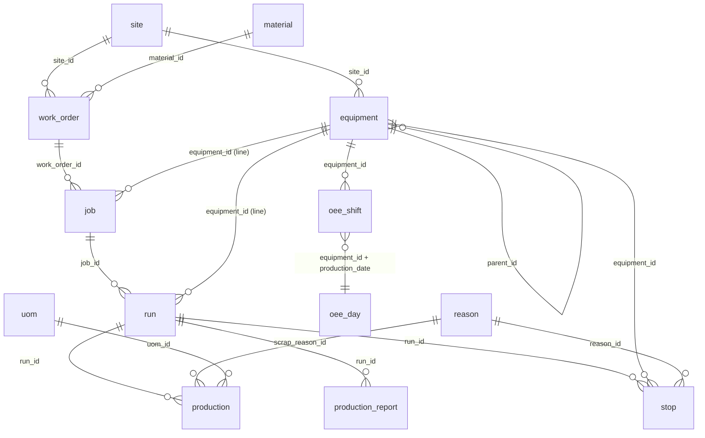

# Reporting on Pulaski data

Pulaski doesn't build dashboards or ad-hoc reports itself (D-129). Instead it gives analysts a **stable, documented, read-only layer** of
the data in PostgreSQL, the `report` schema, to use from Power BI, Excel, Tableau or a warehouse such as Snowflake. This page is that
layer's guide: what each view holds, how its figures are worked out so a report agrees with the app, and how to connect.

## The promise

- **Read the `report` views, not the tables behind them.** Pulaski's own tables (`core`, `ts`, `evt`, `sec`, documented in
  `design/database.md`) change as features are added. The views keep their names, columns and meaning.
- A view changes only by **gaining columns**. Anything that would break a report (a column renamed, dropped or changing meaning) gets a
  new view name, and the old one stays until a release note retires it.
- The reporting login can read the views and nothing else: not the tables, not the event log, not users or passwords, and it can't write.
- Every view is checked against the real schema on every build (`Tests/Pulaski.Infrastructure.Tests/ReportViewTests.cs`).

## Connecting

A database administrator creates one login per tool, a member of `pulaski_report` (made by `db/report-role.sql`, which the database setup
runs):

```sql
CREATE ROLE powerbi LOGIN PASSWORD '…' CONNECTION LIMIT 5;
GRANT pulaski_report TO powerbi;
GRANT CONNECT ON DATABASE pulaski TO powerbi;
-- Settings are per login (a group role's don't pass on): stop long queries, and never write.
ALTER ROLE powerbi SET statement_timeout = '5min';
ALTER ROLE powerbi SET default_transaction_read_only = on;
```

Connect to the `pulaski` database with that login, `sslmode=require` outside the plant network, and choose tables from the `report` schema.
For heavy use, point the login at a read replica rather than the database the floor writes to.

## Conventions

- **Ids** are UUIDs (`…_id`). Join on them, never on codes: a code can be reused once its thing is switched off.
- **Times** are `timestamptz`: an instant, sent in UTC. Show them in the site's time zone (`report.site.time_zone`).
  `site_local_date` is the calendar day at the site, worked out for you. `production_date` (OEE) is the shift's production day, which can
  differ from the calendar day for a night shift.
- **Quantities** are in the unit on the row (`uom_id` → `report.uom`). A material's stock is in its base unit
  (`report.material.base_uom_id`). Pulaski converts units only where it says so; don't add quantities in different units.
- **Nothing is deleted.** Things are switched off (`is_active`), stops replaced by splits and merges are left out of `report.stop`, and a
  reversed report nets to zero. Filter `is_active` for "current" lists, not for history.
- **Codes and statuses** are lower-case English words with underscores (`in_progress`, `equipment_capability`).

## How the views join



Dimensions: `site`, `equipment`, `material`, `uom`, `reason`, `person`, `characteristic`. Facts: `work_order`, `job`, `run`, `production`,
`production_report`, `stop`, `oee_shift`, `oee_day`, `lot`, `stock`, `lot_movement`, `lot_genealogy`, `labor_session`, `quality_result`,
`spc_alert`, `nonconformance`, `nonconformance_lot`.

Inventory, labor and quality join the same way: `lot` and `lot_movement` to `material`, `equipment` (location) and `job`; `lot_genealogy` to
`lot` twice (parent, child); `labor_session` to `person`, `equipment` and `job`; `quality_result` to `characteristic`, `material`, `lot`,
`job` and `run`; `nonconformance_lot` between `nonconformance` and `lot`.

## Dimensions

### report.site

One row per site. `site_id`, `code`, `name`, `time_zone` (IANA, such as `America/Chicago`), `is_active`.

### report.equipment

One row per piece of equipment below the enterprise: sites, areas, lines, machines, storage. `equipment_id`, `site_id`, `code`, `name`,
`level` (ISA-95: `site`, `area`, `work_center`, `work_unit`…), `role` (`production_line`, `storage_zone`, `feed_point`…), `parent_id` /
`parent_code`; `area_id` / `area_code`, the nearest area above it; `line_id` / `line_code`, the nearest piece that runs jobs, itself included
(so a machine reports under its line); flags `can_run_job`, `is_schedulable`, `holds_inventory`, `tracks_state`, `is_active`.

### report.material

`material_id`, `code`, `name`, `material_type` (`raw`, `finished`, `packaging`…), `class_code` / `class_name`, `base_uom_id` /
`base_uom_code`, `is_lot_tracked`, `shelf_life_days`, `origin` (`local`, `erp`), `external_system` / `external_key` (the ERP's key, for
joining to ERP data), `is_active`.

### report.uom

`uom_id`, `code`, `name`, `dimension` (`mass`, `length`, `count`…).

### report.reason

Reasons of every kind: scrap, holds, stops (utilization), adjustments, SPC causes. `reason_id`, `site_id` (null: every site), `kind`, `code`,
`name`, `utilization_class` (stops: `runtime`, `downtime` or `planned`, which is left out of availability), `oee_impact`, `group_path`
(the groups above it, such as `Mechanical › Die`), `depth`, `is_group` (a group, not chosen itself), `is_active`.

## Production and OEE

### report.production: every change to good and scrap

**Grain:** one row per counted change. **Use it for totals.** `production_id`, `occurred_at` (when it counts: inside its run),
`site_local_date`, `recorded_at` (when it was entered), `equipment_id` (the line), `run_id`, `job_id`, `report_id`, `change_kind`, `good_qty`,
`scrap_qty`, `uom_id`, `scrap_reason_id`, `actor_id`.

`change_kind` is `report` (an operator's or station's report), `reversal` (a report taken back: negative quantities), or `rejection` (a lot
rejected on quality: its quantity moves from good to scrap in the run that made it, without a report). Summed by run, these equal
`report.run.good_qty` and `scrap_qty`. Machine counts aren't reports and aren't here.

### report.production_report: one row per report

**Grain:** one production report, net of any reversal. `report_id`, `job_id`, `run_id`, `equipment_id`, `occurred_at`, `site_local_date`,
`recorded_at`, `good_qty`, `scrap_qty`, `uom_id`, `scrap_reason_id`, `is_reversed` (taken back: nets to zero; a correction is a new report),
`machine_through` (a report from the machine's count: counts up to this time are in it), `reported_by`. Use it for questions about
reports (how many, by whom, how late); for quantities use `report.production`, which also has rejections.

### report.run

**Grain:** one run: a job on a line from start to pause or completion. `run_id`, `job_id`, `equipment_id` (the line), `run_no` (1, 2…
within the job), `started_at`, `ended_at` (null while running), `status` (`running`, `paused`, `ended`), `end_reason_id`, `good_qty`,
`scrap_qty`, `uom_id`, `hours` (to now while running).

### report.stop

**Grain:** one stop as it stands now. `stop_id`, `equipment_id`, `run_id`, `started_at`, `ended_at`, `minutes` (to now while open),
`site_local_date`, `packml_state` / `packml_state_name` (the PackML state it started in), `plc_stop_reason` (the machine's own code),
`reason_id`, `utilization_class`, `is_uncoded`, `is_micro_stop` (shorter than the machine's threshold: not availability loss), `is_open`,
`source` (`machine`, `manual`, `split`, `merge`, `retime`, `restore`, `trim`), `coded_by`, `comment`. Pieces replaced by a split, merge or
retime are left out, so stops never overlap.

### report.oee_shift and report.oee_day

**Grain:** one piece of equipment in one shift (`oee_shift`), or one production day (`oee_day`, its shifts added up). From the daily OEE
rollups, so **only final days are here: up to two days ago.** Today's and yesterday's figures are the app's (Machines → Utilization and OEE).

Columns: `site_id`, `equipment_id`, `production_date`; `oee_shift` also `shift_code`, `shift_name`, `crew`, `window_start`, `window_end`,
`rolled_at`. Hours: `scheduled_hours`, `non_production_hours`, `planned_stop_hours`, `planned_hours`, `run_hours`, `down_hours`,
`micro_stop_hours`, `no_signal_hours` (no machine signal: counted as down), `uncoded_hours`, `run_with_rate_hours`; counts `stops`,
`micro_stops`; output `good_qty`, `scrap_qty` (from production reports, never machine counts), `earned_hours`, `earned_good_hours`; and
`availability`, `performance`, `quality`, `oee` as fractions (0.85 = 85%).

**How OEE is worked out**, exactly as the app does it (D-052):

| Figure | Formula |
| --- | --- |
| Planned time | scheduled − non-production − planned stops |
| Availability | run ÷ planned |
| Performance | earned hours ÷ run time with a rate (earned hours = output ÷ ideal rate) |
| Quality | earned good hours ÷ earned hours |
| OEE | availability × performance × quality |

Output is weighed by each product's ideal rate, so a line making several products in a shift is compared fairly. **Never average the
ratios**: to roll up shifts, days, lines or a site, add the hours and recompute, as `oee_day` does:

```sql
SELECT e.line_code, date_trunc('month', o.production_date) AS month,
       sum(o.run_hours) / nullif(sum(o.planned_hours), 0)            AS availability,
       sum(o.earned_hours) / nullif(sum(o.run_with_rate_hours), 0)   AS performance,
       sum(o.earned_good_hours) / nullif(sum(o.earned_hours), 0)     AS quality
FROM report.oee_day o JOIN report.equipment e USING (equipment_id)
WHERE e.can_run_job
GROUP BY e.line_code, month;
```

## Orders and jobs

### report.work_order

**Grain:** one work order. `work_order_id`, `site_id`, `order_number`, `material_id`, `planned_qty`, `uom_id`, `status` (`planned`,
`dispatched`, `firmed`, `in_progress`, `completed`, `closed`, `cancelled`), `priority`, `planned_start`, `planned_end`, `due_at`, `origin`,
`external_system` / `external_key` (the ERP's order), `created_at`; from its production jobs: `good_qty` and `scrap_qty` (jobs in the order's
unit), `first_started_at`, `last_ended_at`, `job_count`.

### report.job

**Grain:** one job. `job_id`, `site_id`, `work_order_id`, `job_number`, `job_type` (`production`, `changeover`, `maintenance`…),
`equipment_id` (the line it runs on), `group_equipment_id` (the department it was planned to, if any), `material_id`, `operation_number`,
`planned_qty`, `uom_id`, `status`, `planned_start`, `planned_end`, `completed_at`, `created_at`; from its runs: `good_qty`, `scrap_qty`,
`first_started_at`, `last_ended_at`, `run_count`, `run_hours`.

Plan against actual for an order:

```sql
SELECT w.order_number, m.code AS material, w.planned_qty, w.good_qty, w.good_qty / nullif(w.planned_qty, 0) AS done, u.code AS unit,
       w.due_at, w.last_ended_at, w.last_ended_at > w.due_at AS late
FROM report.work_order w JOIN report.material m USING (material_id) JOIN report.uom u USING (uom_id)
WHERE w.status <> 'cancelled';
```

## Inventory and genealogy

### report.lot

**Grain:** one lot as it is now. `lot_id`, `site_id`, `lot_number` (null for a balance), `label` (the lot number, or `@LOCATION` for a balance
that has none), `material_id`, `status` (`planned`, `in_production`, `available`, `on_hold`, `quarantine`, `consumed`, `scrapped`,
`shipped`, `cancelled`), `quantity` (in the material's base unit), `uom_id`, `location_id`, `container_id`, `is_bulk` (a balance where lots
mix: one per material and location), `origin` (`produced`, `received`, `erp`, `split`, `merge`), `supplier_lot`, `expires_at`,
`produced_by_job_id`, `produced_by_run_id`, `created_at`, `updated_at`, `is_on_hand` (available, on hold or in quarantine).

### report.stock

**Grain:** site × material × location × status, on hand now. `site_id`, `material_id`, `location_id`, `status`, `uom_id`, `lot_count`,
`quantity`, `first_expires_at`.

### report.lot_movement

**Grain:** one movement of one lot. `movement_id`, `recorded_at` (when it was entered), `effective_at` (when it counts in stock: earlier
when back-dated, at most 31 days), `site_local_date` (of `effective_at`), `lot_id`, `site_id`, `material_id`, `kind` (`received`, `moved`,
`loaded`, `consumed`, `produced`, `split`, `merged`, `status_changed`, `adjusted`, `scrapped`, `shipped`, `corrected`, `reversed`, `packed`,
`unpacked`, `created`), `qty_delta` (+ in, − out; null when the quantity didn't change), `qty_after`, `uom_id`, `from_location_id`,
`to_location_id`, `related_lot_id` (the other lot of a split, merge or transfer), `container_id`, `job_id` and `run_id` (consumption into
or production from a job), `from_status` / `to_status`, `reason_id`, `reference` (a shipment or count number), `reverses_movement_id` (this
undoes that movement), `is_reversed` (a later movement undid this one), `report_id` (the production report that made it), `auto_source`
(`backflush`, `time_window`, `counter`: consumed by Pulaski itself), `actor_id`, `comment`.

**Stock at a time** is the sum of `qty_delta` with `effective_at` up to that time, never `qty_after`:

```sql
SELECT m.code, sum(v.qty_delta) AS quantity_at_month_end
FROM report.lot_movement v JOIN report.material m USING (material_id)
WHERE v.effective_at < date '2026-12-01' AND v.site_id = :site
GROUP BY m.code;
```

A reversal is a movement of its own that offsets the one it undoes: sum every row (they cancel), or leave out both
(`reverses_movement_id IS NULL AND NOT is_reversed`), never only one.

### report.lot_genealogy

**Grain:** one link from a lot used (`parent_lot_id`) to a lot made from it (`child_lot_id`). `link_id`, `link_basis` (`declared`: both
declared on the same job; `made_from`: picked for that lot; `split`, `merge`, `rework`, `time_window`), `quantity`, `uom_id`, `job_id`,
`run_id`, `effective_at`, `derived_at`. Links later replaced are left out. These are the stored links: the app also pairs each used lot with
the lots made while it was in use (by time) when it shows a trace, and that pairing isn't stored, so a trace here is at job level.

Every lot made from a raw lot, through any number of steps:

```sql
WITH RECURSIVE down AS (
    SELECT child_lot_id, 1 AS depth FROM report.lot_genealogy WHERE parent_lot_id = :raw_lot
    UNION
    SELECT g.child_lot_id, d.depth + 1 FROM report.lot_genealogy g JOIN down d ON g.parent_lot_id = d.child_lot_id WHERE d.depth < 20
)
SELECT l.label, m.code, l.status, l.quantity, d.depth
FROM down d JOIN report.lot l ON l.lot_id = d.child_lot_id JOIN report.material m USING (material_id);
```

## Labor

### report.person

`person_id`, `site_id`, `employee_number`, `display_name`, `crew_id` / `crew_code` / `crew_name`, `origin` (`local`, `hr`, `erp`),
`external_system` / `external_key` (the HR or ERP key), `is_active`.

### report.labor_session

**Grain:** one stretch of a person's time as it stands now: a correction replaces the session it corrects, and a void correction removes
it. `session_id`, `site_id`, `person_id`, `equipment_id` (the line), `job_id`, `labor_type` (`direct`, `setup`, `indirect`, `training`),
`reason_id` (indirect time's reason), `started_at`, `ended_at` (null while on), `allocation_pct` (the share of their time on this line),
`production_date` and `shift_code` (the shift it belongs to), `source` (`self`, `supervisor`, `crew`, `terminal`, `correction`), `elapsed_hours`,
`break_hours` (the person's breaks inside it, paid or not), `worked_hours` = (elapsed − breaks) × share, `is_open`, `is_approved` (its
shift's labor is approved, so it won't change).

Direct hours per job, as the app shares them out to runs, aren't here when a session names no job (the app shares them by overlap with
what ran); sum `worked_hours` by `equipment_id` and day for line totals.

## Quality

### report.characteristic

`characteristic_id`, `code`, `name`, `data_kind` (`variable`: measured; `attribute`: inspected for defects), `chart_type`, `subgroup_size`,
`uom_id`, `decimals`, `is_active`.

### report.quality_result

**Grain:** one result: a subgroup measured or a sample inspected. `result_id`, `sampled_at`, `site_local_date`, `recorded_at`, `site_id`,
`characteristic_id`, `material_id`, `equipment_id`, `job_id`, `run_id`, `lot_id`; measured: `subgroup_size`, `mean`, `range`, `std_dev`,
`measured_values` (an array); inspected: `inspected_count`, `defect_count`; the limits it was checked against: `lsl`, `target`, `usl`,
`max_defects`; `conforms` (null: no limits applied), `source` (`manual`, `lab`, `auto`, `lot_attribute`), `recorded_by`, `is_excluded` and
`exclusion_reason_id` (left out of charts and certificates, kept on record). Leave out `is_excluded` rows for any figure.

### report.spc_alert

**Grain:** one SPC alert: a control chart that signaled, open until closed. `alert_id`, `site_id`, `characteristic_id`, `material_id`,
`equipment_id`, `status` (`open`, `closed`), `rules` (the Nelson rules broken), `breaks` (how many results broke them), `raised_at`,
`closed_at`, `closed_by`, `cause_reason_id`, `action`, `open_hours`.

### report.nonconformance and report.nonconformance_lot

**Grain:** one NCR. `ncr_id`, `site_id`, `number`, `title`, `severity` (`minor`, `major`, `critical`), `status` (`open`, `investigating`,
`acting`, `closed`), `source_kind`, `raised_at`, `raised_by`, `root_cause`, `disposition`, `closed_at`, `closed_by`, `open_days`,
`action_count`, `open_actions`, `overdue_actions`. `report.nonconformance_lot` (`ncr_id`, `lot_id`) gives the lots each one concerns.

## Power BI

1. In Power BI Desktop: **Get data → PostgreSQL database**. Server `host:5432` (the database server, or a read replica), database
   `pulaski`. Choose **Import** (recommended: fast, and the views are small enough) or **DirectQuery** (always current, but every visual is a
   query on the database).
2. Sign in with the reporting login (**Database** credentials). Use an encrypted connection outside the plant network.
3. In the navigator, pick the views you need from the `report` schema; nothing else is offered to that login.
4. In **Model**, relate them as in the diagram above: `*_id` to the dimension's `*_id`, single direction from dimension to fact. Give the
   equipment view two roles when you need both the line and the machine (`line_id` and `equipment_id`).
5. To refresh in the Power BI service, publish the report and set up a data gateway that can reach the database, with the same login.

OEE measures, adding hours first:

```
Planned hours   = SUM ( oee_day[planned_hours] )
Availability    = DIVIDE ( SUM ( oee_day[run_hours] ), [Planned hours] )
Performance     = DIVIDE ( SUM ( oee_day[earned_hours] ), SUM ( oee_day[run_with_rate_hours] ) )
Quality         = DIVIDE ( SUM ( oee_day[earned_good_hours] ), SUM ( oee_day[earned_hours] ) )
OEE             = [Availability] * [Performance] * [Quality]
```

Times arrive in UTC: add a column in the site's time zone when you show them, or use `site_local_date` and `production_date`.

## Getting the data into a warehouse (Snowflake and others)

**Main route: copy the views on a schedule.** Use a replication or ELT tool that can read **views** or run a query on PostgreSQL, with the
reporting login. Tools that replicate by change data capture (logical replication) copy tables, not views; use their query or standard
(non-CDC) mode for the `report` schema. How to copy each view:

| Views | How | Why |
| --- | --- | --- |
| `site`, `equipment`, `uom`, `material`, `reason`, `person`, `characteristic` | Full copy each time | Small; things are edited in place |
| `lot`, `stock`, `work_order`, `job`, `run`, `spc_alert`, `nonconformance`, `nonconformance_lot` | Full copy, or by `updated_at` where the view has it | Current state, which changes |
| `production`, `lot_movement`, `quality_result` | Incremental on `recorded_at`, with an hour's overlap; merge on the id | Append-only: a correction or reversal is a new row (a quality result's exclusion changes the row: copy the last 31 days again) |
| `production_report` | The last 31 days again, merged on `report_id` | A reversal changes `is_reversed` and the net quantities |
| `stop` | The last 31 days again, merged on `stop_id` | Stops are coded, split, merged or retimed up to 31 days back |
| `labor_session` | The last 31 days again, merged on `session_id` | Corrections replace sessions until the shift is approved |
| `oee_shift`, `oee_day` | Incremental on `rolled_at` (re-rolled days come again), merged on equipment + day + shift | A changed day is rolled again |
| `lot_genealogy` | Full copy | Links are replaced as well as added |

Without such a tool, a scheduled job can extract and load directly, for example:

```bash
psql "$PULASKI_REPORT_URL" -c "\copy (SELECT * FROM report.lot_movement WHERE recorded_at > '$SINCE') TO 'lot_movement.csv' CSV HEADER"
# then in Snowflake: PUT the file to a stage and COPY INTO the table, merging on movement_id
```

**Near real time: the event feeds.** Pulaski already sends what happens as it happens, as CloudEvents JSON, to a webhook or an MQTT broker
(Configure → Integrations, D-061, D-088): inventory movements, production reports, work orders and jobs, labor, stops, quality results. A
pipeline that receives them (an HTTPS endpoint or an MQTT bridge into a stream your warehouse ingests) gives minute-fresh data. Each event's
`id` is unique: dedupe on it, since delivery is at least once. Keep the scheduled copy of the views as the source of truth, and use the feed
for live dashboards.
## What the views don't have (yet)

- **Production by shift.** A report belongs to the shift running at its time, which Pulaski works out from the shift schedule when it reads;
  only OEE (`oee_shift`) is stored by shift. Group production by `site_local_date`, or join it to `oee_shift` windows by time
  (`occurred_at >= window_start AND occurred_at < window_end`) on the same line.
- **Today's OEE.** The rollups are written for days that are final (up to two days ago).
- **Machine counts** (raw counters and process values) aren't in the views; they are telemetry, not records.
- **Per-lot genealogy by time** (which lot was in use when each lot was made) is worked out by the app when it shows a trace; the views have
  the stored, job-level links.
- **Direct labor shared out to runs** by overlap is the app's; the views give each session's worked hours.
